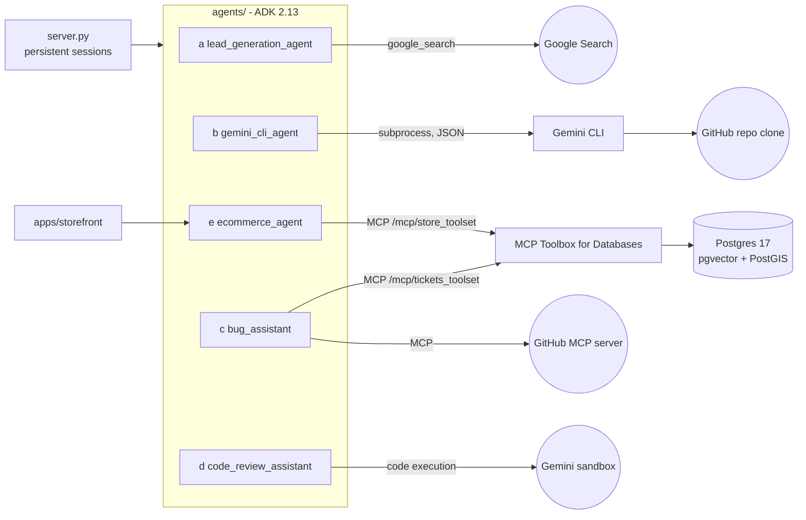

# Assignment 3: End-to-end Google ADK agent applications

Five agents built with the [Google Agent Development Kit](https://google.github.io/adk-docs/)
(ADK 2.13, Python), each run end to end against live Gemini models, with all code,
infrastructure, tests, execution transcripts and a code walkthrough in this repo.

| | Agent | Package | Key ADK features | Transcript |
|---|---|---|---|---|
| a | Deep research agent for lead generation | [`agents/lead_generation_agent`](agents/lead_generation_agent) | AgentTool, SequentialAgent, runtime-built ParallelAgent fan-out, custom BaseAgent, output_schema, google_search, callbacks | [run](docs/runs/lead_generation_agent.md) |
| b | Advanced tool agent: Gemini CLI as a tool inside an ADK pipeline | [`agents/gemini_cli_agent`](agents/gemini_cli_agent) | FunctionTools wrapping `gemini -p` (headless, JSON), SequentialAgent + ParallelAgent pipeline | [run](docs/runs/gemini_cli_agent.md) |
| c | MCP-tools-based agent for bug assistance | [`agents/bug_assistant`](agents/bug_assistant) | McpToolset (MCP Toolbox for Databases + GitHub MCP), LangchainTool, AgentTool(google_search), FunctionTool | [run](docs/runs/bug_assistant.md) |
| d | Production-quality code review assistant | [`agents/code_review_assistant`](agents/code_review_assistant) | Sequential + Loop agents, BuiltInCodeExecutor, deterministic tools, artifacts, `user:` state, persistent sessions | [run](docs/runs/code_review_assistant.md) |
| e | Production-quality e-commerce agent | [`agents/ecommerce_agent`](agents/ecommerce_agent) + [`apps/storefront`](apps/storefront) | McpToolset over MCP Toolbox (pgvector + PostGIS), before_tool_callback identity pinning, confirmation guard, storefront app | [run](docs/runs/ecommerce_agent.md) |

- **Code walkthrough** (architecture diagrams, file-by-file tour, changes vs. each
  reference): [`docs/WALKTHROUGH.md`](docs/WALKTHROUGH.md)
- **Video walkthrough (YouTube):** _link to be added_
- **Video recording script:** [`docs/VIDEO_SCRIPT.md`](docs/VIDEO_SCRIPT.md)

## Requirements checklist

| Requirement | Where it is satisfied |
|---|---|
| Build agents end to end | All five run against live Gemini through the scripted runner (`scripts/run_agent.py`), the ADK dev UI (`adk web agents`), and the production server (`server.py`). Transcripts are in `docs/runs/`. |
| (a) Deep research lead generation agent | `agents/lead_generation_agent`, based on the Google Cloud deep-research blog and MagnIeeT/leadGenerationAgentADK |
| (b) Gemini CLI used as a tool inside an ADK pipeline | `agents/gemini_cli_agent`, based on derrickchwong/gemini-cli-on-adk; Cloud Run-ready `Dockerfile` installs the CLI |
| (c) MCP tools agent for bug assistance | `agents/bug_assistant` + `infra/toolbox/tools.yaml` (tickets toolset), based on google/adk-samples software-bug-assistant |
| (d) Production-quality code review assistant | `agents/code_review_assistant`, `server.py`, `Dockerfile`, `deploy/cloud_run.sh`, `tests/`, based on ayoisio/adk-code-review-assistant |
| (e) Production-quality e-commerce agent | `agents/ecommerce_agent`, `apps/storefront`, `infra/` (Postgres + MCP Toolbox), based on mtoscano84/sports-agent-adk-mcp-alloydb |
| All artifacts in GitHub | Code, SQL, Toolbox config, Dockerfiles, deploy script, tests, transcripts and docs are all in this repo |
| Detailed code and execution walkthrough | `docs/WALKTHROUGH.md` (code), `docs/runs/*.md` (execution), `docs/VIDEO_SCRIPT.md` (video) |
| YouTube video | Link above |

## Architecture at a glance



## Run it

Prerequisites: Python 3.12+ with [uv](https://docs.astral.sh/uv/), Docker (Docker
Desktop or Colima), Node 20+ for the Gemini CLI, and a Gemini API key from
[AI Studio](https://aistudio.google.com/apikey) (or a billing-enabled Vertex AI project).

```bash
git clone https://github.com/nitishsancs/adk-agents-assignment3 && cd adk-agents-assignment3
cp .env.example .env            # put GOOGLE_API_KEY in it
uv sync
npm install -g @google/gemini-cli@0.66.0           # part (b)

# Databases + MCP Toolbox for parts (c) and (e)
docker compose -f infra/docker-compose.yml --env-file .env up -d --build
uv run python scripts/embed_backfill.py             # 768-d gemini-embedding-001 vectors

uv run pytest -q                                     # 15 offline unit tests
uv run adk web agents                                # dev UI with all five agents, http://127.0.0.1:8000
```

Other entry points:

```bash
# Scripted end-to-end run that writes docs/runs/<agent>.md
uv run python scripts/run_agent.py ecommerce_agent "I need trail running shoes" "Which store near me has them?"

# Production API for all agents (SQLite sessions locally; Cloud SQL via SESSION_SERVICE_URI)
uv run uvicorn server:app --port 8080          # GET /healthz, POST /run, /run_sse, ...

# Storefront for part (e)
uv run uvicorn apps.storefront.main:app --port 8081   # http://127.0.0.1:8081

# Deploy everything to Cloud Run + Cloud SQL (needs billing)
PROJECT_ID=my-project GOOGLE_API_KEY=... ./deploy/cloud_run.sh
```

MCP Toolbox listens on host port **5050**, because macOS's AirPlay Receiver holds port 5000.

## Repository layout

```
agents/                       one ADK package per part; `adk web agents` lists all five
  lead_generation_agent/      (a) agent.py, prompts.py, schemas.py, sub_agents/{pipelines,fanout}.py
  gemini_cli_agent/           (b) agent.py (pipeline), tools.py (CLI wrapper)
  bug_assistant/              (c) agent.py (MCP + other tools), prompt.py
  code_review_assistant/      (d) agent.py, tools.py, config.py, sub_agents/{review,fix}.py
  ecommerce_agent/            (e) agent.py (identity + confirmation guards), prompt.py
apps/storefront/              (e) FastAPI storefront: sign-in, SSE chat UI
infra/
  docker-compose.yml          Postgres (pgvector + PostGIS) and MCP Toolbox
  toolbox/tools.yaml          22 SQL tools in two MCP toolsets
  sql/                        ticket schema + seeds, sanitized sports-store dump
scripts/
  run_agent.py                scripted multi-turn runner that writes transcripts
  embed_backfill.py           fills vector columns (rate-limit aware)
  sanitize_store_dump.py      AlloyDB dump -> plain Postgres
server.py, Dockerfile         production API server + image (includes Gemini CLI)
deploy/cloud_run.sh           Cloud SQL, Secret Manager, Toolbox, agents, storefront
tests/test_offline.py         unit tests for every agent's deterministic logic
docs/                         WALKTHROUGH.md, VIDEO_SCRIPT.md, runs/*.md
```

## Notes

- **Models:** the code defaults to `gemini-flash-latest`; set `FAST_MODEL` / `SMART_MODEL`
  in `.env` to change it. Every agent uses a retrying model handle (`agents/*/model.py`),
  because free-tier Gemini returns transient 429/503 errors under load.
- **Not deployed:** the Cloud Run script is included but was not run for this submission.
  Everything was verified locally.
- **Credits:** each agent adapts the reference implementation linked in the assignment.
  The changes are listed per agent in `docs/WALKTHROUGH.md`. The sports-store data and
  seed tickets come from those Apache-2.0 samples.
