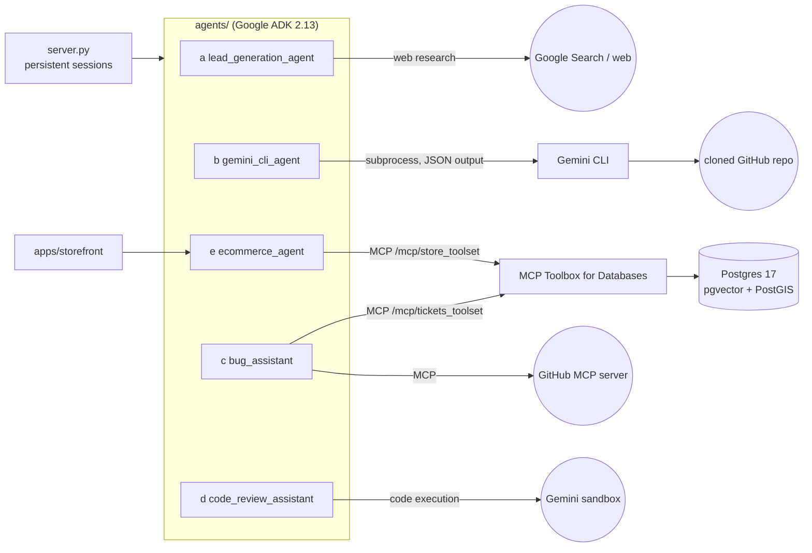
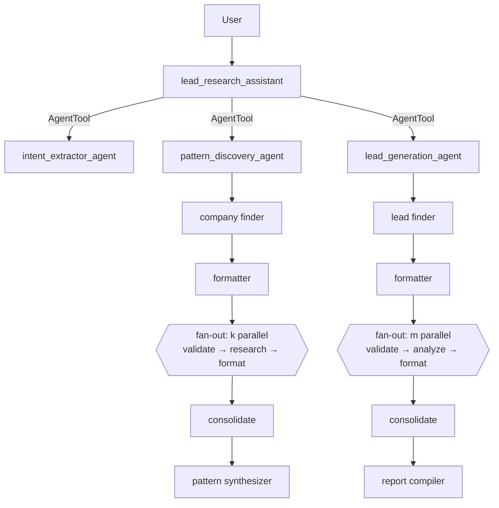
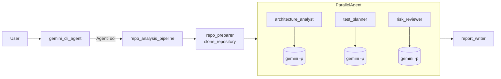
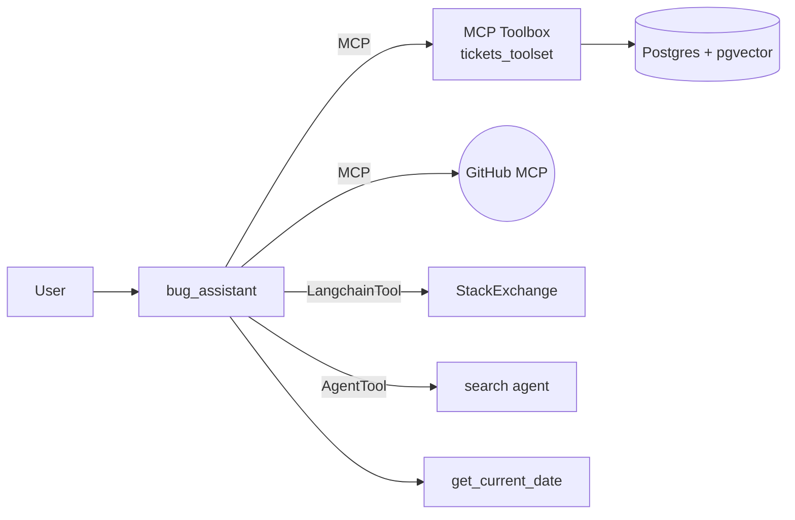
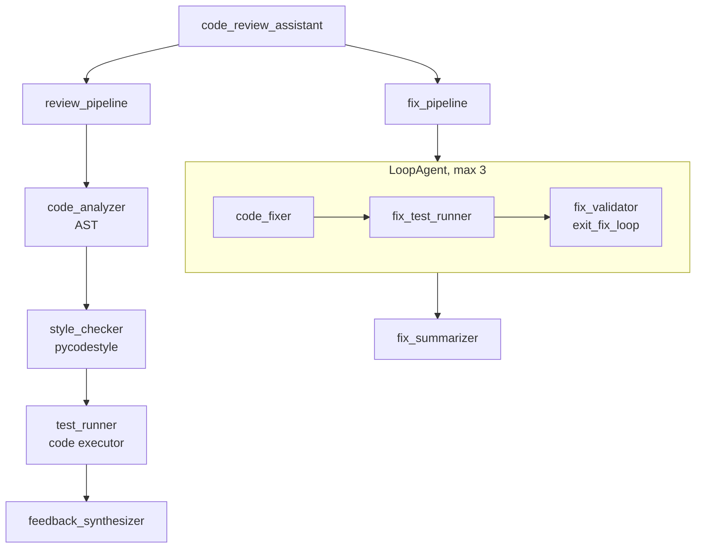
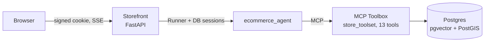

# Google ADK Agents: Five End-to-End Applications

[](https://www.youtube.com/watch?v=YOUR_VIDEO_ID)


Assignment 3: five agent applications built with the
[Google Agent Development Kit (ADK)](https://google.github.io/adk-docs/), each one run
end to end against live Gemini models. The repo holds the code, infrastructure, tests,
execution transcripts and a full code walkthrough.

| | Agent | What it shows |
|---|---|---|
| **a** | [Deep research lead generation](#a-deep-research-agent-for-lead-generation) | Multi-agent deep research with parallel fan-out sized at run time |
| **b** | [Gemini CLI tool agent](#b-advanced-tool-agent-gemini-cli-inside-an-adk-pipeline) | The Gemini CLI used as a tool inside a Sequential + Parallel ADK pipeline |
| **c** | [MCP bug assistant](#c-mcp-tools-agent-for-bug-assistance) | MCP Toolbox for Databases, GitHub MCP, LangChain and search tools on one agent |
| **d** | [Code review assistant](#d-production-quality-code-review-assistant) | Review pipeline with executed tests, a self-correcting fix loop, and memory |
| **e** | [E-commerce agent](#e-production-quality-e-commerce-agent) | Shopping assistant over MCP + Postgres, with identity pinning and a storefront |

---

## 🎬 Video walkthrough

> **▶️ YouTube: [https://www.youtube.com/watch?v=YOUR_VIDEO_ID](https://www.youtube.com/watch?v=YOUR_VIDEO_ID)**
>
> _Placeholder: replace `YOUR_VIDEO_ID` with the uploaded video's ID._

[](https://www.youtube.com/watch?v=YOUR_VIDEO_ID)

| Chapter | Topic |
|---|---|
| 00:00 | Intro and repository tour |
| 01:00 | (a) Deep research lead generation agent |
| 05:00 | (b) Gemini CLI as a tool in an ADK pipeline |
| 08:00 | (c) MCP bug assistant |
| 11:00 | (d) Code review assistant |
| 14:00 | (e) E-commerce agent and storefront |
| 18:00 | Tests, transcripts and wrap-up |

The shot list for the recording is in [`docs/VIDEO_SCRIPT.md`](docs/VIDEO_SCRIPT.md).

---

## Contents

- [Requirements checklist](#requirements-checklist)
- [Architecture](#architecture)
- [Quick start](#quick-start)
- [The five agents](#the-five-agents)
- [Production features](#production-features)
- [Configuration](#configuration)
- [Testing and execution evidence](#testing-and-execution-evidence)
- [Repository layout](#repository-layout)
- [Troubleshooting](#troubleshooting)
- [Credits](#credits)

---

## Requirements checklist

| Assignment requirement | Delivered in |
|---|---|
| (a) Deep research agent for lead generation | [`agents/lead_generation_agent`](agents/lead_generation_agent) · [transcript](docs/runs/lead_generation_agent.md) |
| (b) Advanced tool agent using the Gemini CLI as a tool inside an ADK pipeline | [`agents/gemini_cli_agent`](agents/gemini_cli_agent) · [transcript](docs/runs/gemini_cli_agent.md) |
| (c) MCP-tools-based agent for bug assistance | [`agents/bug_assistant`](agents/bug_assistant), [`infra/toolbox/tools.yaml`](infra/toolbox/tools.yaml) · [transcript](docs/runs/bug_assistant.md) |
| (d) Production-quality code review assistant | [`agents/code_review_assistant`](agents/code_review_assistant), [`server.py`](server.py), [`Dockerfile`](Dockerfile), [`deploy/`](deploy) · [transcript](docs/runs/code_review_assistant.md) |
| (e) Production-quality e-commerce agent | [`agents/ecommerce_agent`](agents/ecommerce_agent), [`apps/storefront`](apps/storefront), [`infra/`](infra) · [transcript](docs/runs/ecommerce_agent.md) |
| Agents built end to end | All five ran against live Gemini; transcripts in [`docs/runs/`](docs/runs) |
| All artifacts in GitHub | Code, SQL, MCP Toolbox config, Dockerfiles, deploy script, tests, transcripts, docs |
| Detailed code walkthrough | [`docs/WALKTHROUGH.md`](docs/WALKTHROUGH.md) |
| Execution walkthrough | [`docs/runs/*.md`](docs/runs) (every agent hop, tool call and reply) |
| YouTube video | [Video walkthrough](#-video-walkthrough) (link placeholder above) |

---

## Architecture



Every agent is a standard ADK package under `agents/`, so a single `adk web agents`
command shows all five in the ADK dev UI, and `server.py` serves all five through one
production API.

---

## Quick start

**Prerequisites:** Python 3.12+ with [uv](https://docs.astral.sh/uv/), Docker (Docker
Desktop or Colima), Node 20+, and a Gemini API key from
[Google AI Studio](https://aistudio.google.com/apikey) (or a billing-enabled Vertex AI project).

```bash
# 1. Clone and install
git clone https://github.com/nitishsancs/adk-agents-assignment3
cd adk-agents-assignment3
uv sync
npm install -g @google/gemini-cli@0.66.0      # needed for part (b)

# 2. Configure
cp .env.example .env                           # then set GOOGLE_API_KEY in .env

# 3. Start Postgres + MCP Toolbox (parts c and e) and embed the data
docker compose -f infra/docker-compose.yml --env-file .env up -d --build
uv run python scripts/embed_backfill.py

# 4. Run
uv run pytest -q                               # 15 offline unit tests
uv run adk web agents                          # ADK dev UI with all five agents
```

Open http://127.0.0.1:8000 and pick an agent from the drop-down.

| Other entry points | Command |
|---|---|
| Storefront for part (e) | `uv run uvicorn apps.storefront.main:app --port 8081`, then open http://127.0.0.1:8081 |
| Production API (all agents) | `uv run uvicorn server:app --port 8080` (`GET /healthz`, `POST /run`, `/run_sse`) |
| Scripted run + transcript | `uv run python scripts/run_agent.py <agent> "turn 1" "turn 2" ...` |
| Deploy to Cloud Run | `PROJECT_ID=my-project GOOGLE_API_KEY=... ./deploy/cloud_run.sh` |

---

## The five agents

### (a) Deep research agent for lead generation

**What it does:** given a request like _"Find fintech leads in Thailand"_, it first learns
what foreign companies did in the months **before** entering that market, then finds
companies showing those same signals **today**.



**How it works**
- The root agent runs an interactive, five-stage workflow: understand the request,
  set the number of companies to study, discover patterns, set the number of leads,
  and generate leads.
- `FanOutResearchAgent` (a custom `BaseAgent`) builds one research pipeline per company
  **at run time** and runs them concurrently in a `ParallelAgent`.
- Research agents produce free text and separate formatter agents turn it into
  Pydantic-validated JSON (`output_schema`).
- Results flow through session state via `state_delta` events, so they survive
  `AgentTool` boundaries.
- Research tools are switchable: built-in `google_search`, or keyless web search with
  page fetching (`SEARCH_BACKEND=ddg`).

**Try it:** `Find fintech leads in Thailand` → `Analyze 2 companies` → `Yes, find 2 leads`

**Key files:** [`agent.py`](agents/lead_generation_agent/agent.py) ·
[`sub_agents/fanout.py`](agents/lead_generation_agent/sub_agents/fanout.py) ·
[`sub_agents/pipelines.py`](agents/lead_generation_agent/sub_agents/pipelines.py) ·
[`prompts.py`](agents/lead_generation_agent/prompts.py)

**Verified run:** it found that KakaoBank and WeBank entered Thailand through the SCBX
virtual-bank consortium, produced three dated and sourced patterns, and ranked two new
leads with outreach angles. [Transcript →](docs/runs/lead_generation_agent.md)

---

### (b) Advanced tool agent: Gemini CLI inside an ADK pipeline

**What it does:** analyzes any public GitHub repository by delegating codebase reading
to the [Gemini CLI](https://github.com/google-gemini/gemini-cli), and can have the CLI
write code such as new unit tests.



**How it works**
- `run_gemini_cli` runs the CLI headless:
  `gemini -p <task> -o json --approval-mode plan`. It uses an argv list (no shell),
  closes stdin, and parses the JSON output.
- The CLI is read-only by default. `allow_edits=true` switches it to `auto_edit` for
  tasks that write files.
- `clone_repository` accepts only `https://github.com/<owner>/<repo>` URLs and guards
  against path traversal.
- `show_repository_changes` shows exactly what the CLI created or modified.

**Try it:** `Analyze this repository end to end: https://github.com/pallets/itsdangerous`,
then `Generate pytest unit tests for TimestampSigner in tests/test_timed_extra.py`

**Key files:** [`tools.py`](agents/gemini_cli_agent/tools.py) · [`agent.py`](agents/gemini_cli_agent/agent.py)

**Verified run:** three CLI analysts ran in parallel and read the repo with the CLI's
own `read_file` and `list_directory` tools. The CLI flagged the SHA-1 default at
`signer.py:46` and wrote a new test file in edit mode.
[Transcript and CLI session logs →](docs/runs/gemini_cli_agent.md)

---

### (c) MCP tools agent for bug assistance

**What it does:** triages and debugs software bugs. It searches existing tickets by
meaning, creates and updates tickets, and researches errors on StackOverflow and the web.



**How it works**
- Ticket tools are SQL statements defined in
  [`infra/toolbox/tools.yaml`](infra/toolbox/tools.yaml) and served over **MCP** by
  MCP Toolbox for Databases. The model never writes SQL.
- Semantic search uses Toolbox's `embeddedBy`. The query text is embedded with
  `gemini-embedding-001` and matched with pgvector cosine distance.
- New tickets are embedded on insert (`valueFromParam`), so they are searchable immediately.
- The agent combines five tool types: MCP, GitHub MCP (read-only filter), LangChain,
  AgentTool and a function tool.

**Try it:**
- `Users say the login page freezes after a few failed password attempts. Is there already a ticket?`
- `What P0 tickets are open?`
- `Create a ticket for the Postgres connection-slot errors, P1, assign to frank.white@example.com`

**Key files:** [`agent.py`](agents/bug_assistant/agent.py) · [`prompt.py`](agents/bug_assistant/prompt.py) ·
[`tools.yaml`](infra/toolbox/tools.yaml) · [`10-tickets.sql`](infra/sql/10-tickets.sql)

**Verified run:** semantic search matched the report to ticket #1. The agent researched
a Postgres error using StackExchange and the web, checked for duplicates before creating
a P1 ticket, and resolved "last 7 days" with the date tool.
[Transcript →](docs/runs/bug_assistant.md)

---

### (d) Production-quality code review assistant

**What it does:** reviews Python code (structure, PEP 8, and **executed** tests),
writes constructive feedback, and can fix the code automatically, re-testing until it passes.



**How it works**
- Deterministic tools produce the facts: AST analysis (complexity, function length,
  docstrings, bare excepts) and a reproducible pycodestyle score.
- Tests really run in Gemini's code-execution sandbox (`BuiltInCodeExecutor`).
- The fix `LoopAgent` stops early only when tests pass and the style score meets the target.
- Reports and fixed code are saved as versioned **artifacts**. Each developer's review
  history lives in `user:` state, so recurring mistakes are called out.

**Try it:** paste [`docs/samples/buggy_stats.py`](docs/samples/buggy_stats.py) with
_"Please review this code"_, then reply _"Yes, please fix these issues"_.

**Key files:** [`tools.py`](agents/code_review_assistant/tools.py) ·
[`sub_agents/review.py`](agents/code_review_assistant/sub_agents/review.py) ·
[`sub_agents/fix.py`](agents/code_review_assistant/sub_agents/fix.py) ·
[`config.py`](agents/code_review_assistant/config.py)

**Verified run:** the executed tests confirmed the sample's real bug (the loop skips
`nums[0]`). The fix loop produced code that passed 10/10 re-run tests and exited early.
[Transcript →](docs/runs/code_review_assistant.md)

---

### (e) Production-quality e-commerce agent

**What it does:** _Finn_, a shopping assistant for a Barcelona sports store chain. It
finds gear, checks stock at nearby stores, manages a shopping list, and places,
changes or cancels orders.



**How it works**
- 13 SQL tools: semantic product search (pgvector), brand and size search,
  per-store inventory, nearest stores (PostGIS `ST_Distance`), shopping list, and
  transactional order placement.
- **Identity pinning:** a `before_tool_callback` overwrites `user_email` on every
  customer tool with the signed-in user set by the server, so the model can't act for
  another customer.
- **Confirmation guard:** `place-order` and `cancel-order` are blocked until the
  customer explicitly confirms.
- The storefront has sign-in validated against the database, an HMAC-signed HttpOnly
  cookie, persistent sessions, streaming replies, and a visible tool trail.

**Try it** (storefront at http://127.0.0.1:8081, sign in as Alicia):
_"I need trail running shoes for wet, rocky trails"_ → _"Which store near me has the
first one in stock?"_ → _"Add it to my list"_ → _"Order it with the cheapest delivery"_ → _"Yes"_

**Key files:** [`agent.py`](agents/ecommerce_agent/agent.py) ·
[`prompt.py`](agents/ecommerce_agent/prompt.py) ·
[`apps/storefront/main.py`](apps/storefront/main.py) ·
[`tools.yaml`](infra/toolbox/tools.yaml)

**Verified run:** it recommended Hoka and Salomon trail shoes, found stock at the
nearest store, **refused to show another customer's orders**, and placed the order
**only after confirmation**. [Transcript →](docs/runs/ecommerce_agent.md)

---

## Production features

| Concern | Implementation |
|---|---|
| Persistent sessions | `DatabaseSessionService` (SQLite locally, Cloud SQL Postgres via `SESSION_SERVICE_URI`) |
| Artifacts | Versioned ADK artifacts; GCS in production via `ARTIFACT_SERVICE_URI=gs://...` |
| Cost and loop safety | `MAX_LLM_CALLS` cap per request; `LoopAgent` limited to 3 attempts |
| Model resilience | `FallbackGemini`: retries 503s and falls back across models when a quota runs out |
| Data access | Parameterized SQL through MCP Toolbox; read tools marked `readOnlyHint` |
| Authorization | Server-set identity, a `before_tool_callback` that pins the user, a confirmation guard |
| Health | `/healthz` on the API server and the storefront |
| Containers | Non-root `Dockerfile` (agents + Gemini CLI) and [`apps/storefront/Dockerfile`](apps/storefront/Dockerfile) |
| Deployment | [`deploy/cloud_run.sh`](deploy/cloud_run.sh): Cloud SQL, Secret Manager, private Toolbox, agents, storefront |

---

## Configuration

Copy [`.env.example`](.env.example) to `.env`.

| Variable | Default | Purpose |
|---|---|---|
| `GOOGLE_API_KEY` | (required) | Gemini API key from AI Studio |
| `GOOGLE_GENAI_USE_VERTEXAI` | `FALSE` | Set `TRUE` (plus `GOOGLE_CLOUD_PROJECT`) to use Vertex AI |
| `FAST_MODEL` / `SMART_MODEL` | `gemini-flash-latest` | Models for worker and reasoning agents |
| `FALLBACK_MODELS` | Gemini 3.x Flash / Flash-Lite list | Models tried when a quota runs out |
| `SEARCH_BACKEND` | `google` | `google` (built-in grounding) or `ddg` (keyless web search) |
| `MCP_TOOLBOX_URL` | `http://127.0.0.1:5050` | MCP Toolbox endpoint for parts (c) and (e) |
| `GITHUB_PERSONAL_ACCESS_TOKEN` | (empty) | Turns on the GitHub MCP tools in part (c) |
| `GEMINI_CLI_MODEL` | `gemini-flash-latest` | Model the Gemini CLI uses in part (b) |
| `DEMO_USER_EMAIL` | `alicia@example.com` | Signed-in customer for part (e) in `adk web` |

---

## Testing and execution evidence

```bash
uv run pytest -q          # 15 offline tests, no API key needed
```

The unit tests cover:
- (a) prompt-injection-safe company rendering and scope bounds
- (b) URL validation and path-traversal guards
- (c)/(e) every toolset tool defined, and every customer tool requiring the pinned user
- (d) AST and PEP 8 analysis and the loop exit
- (e) identity pinning and order confirmation

Live end-to-end transcripts (recorded 2026-10-29) are in [`docs/runs/`](docs/runs).
Each one lists every agent hop, tool call, tool result and final reply:

| Agent | Transcript |
|---|---|
| (a) Lead generation | [`lead_generation_agent.md`](docs/runs/lead_generation_agent.md) |
| (b) Gemini CLI pipeline | [`gemini_cli_agent.md`](docs/runs/gemini_cli_agent.md) |
| (c) Bug assistant | [`bug_assistant.md`](docs/runs/bug_assistant.md) |
| (d) Code review | [`code_review_assistant.md`](docs/runs/code_review_assistant.md) |
| (e) E-commerce | [`ecommerce_agent.md`](docs/runs/ecommerce_agent.md) |

**Known limitations of the recorded runs:**
- The runs used a free-tier key (about 20 requests per model per day, and no Google
  Search grounding quota). The transcripts therefore span several Gemini Flash and
  Flash-Lite models and use `SEARCH_BACKEND=ddg`.
- In (a), one lead is cited only as "internal research" and the report ends by
  repeating a question. The prompts have since been tightened.
- In (b), the CLI-generated tests were not executed.
- In (c), the GitHub MCP server is wired up but was not exercised, because no token
  was configured.
- The Cloud Run deploy script is included but was not run. Everything was verified locally.

---

## Repository layout

```
agents/                       one ADK package per part (adk web agents lists all five)
  lead_generation_agent/      (a) root agent, prompts, schemas, fan-out research
  gemini_cli_agent/           (b) pipeline + Gemini CLI tools
  bug_assistant/              (c) MCP + LangChain + search tools
  code_review_assistant/      (d) review and fix pipelines, deterministic tools
  ecommerce_agent/            (e) MCP store tools, identity and confirmation guards
apps/storefront/              (e) FastAPI storefront with sign-in and streaming chat
infra/
  docker-compose.yml          Postgres (pgvector + PostGIS) and MCP Toolbox
  toolbox/tools.yaml          22 SQL tools in two MCP toolsets
  sql/                        ticket schema and seeds, sanitized sports-store data
scripts/                      run_agent.py, embed_backfill.py, sanitize_store_dump.py, ...
server.py · Dockerfile        production API server and container image
deploy/cloud_run.sh           Google Cloud deployment
tests/                        offline unit tests
docs/                         WALKTHROUGH.md, VIDEO_SCRIPT.md, runs/, samples/
```

---

## Troubleshooting

| Symptom | Fix |
|---|---|
| `403 Forbidden` from `127.0.0.1:5000` | macOS AirPlay Receiver uses port 5000; Toolbox is on **5050** |
| `429 RESOURCE_EXHAUSTED` | Free-tier quota reached. The agents fall back across models automatically; for more, use a key from another project or enable billing |
| Search tool fails with 429 | Google Search grounding has no free-tier quota; set `SEARCH_BACKEND=ddg` |
| Gemini CLI hangs | Run with stdin closed (the tool already does this): `gemini -p ... < /dev/null` |
| `docker compose` not found | Install the compose plugin (`brew install docker-compose`) |
| Postgres image fails on Apple Silicon | Use the provided `infra/postgres/Dockerfile` (multi-arch pgvector base + PostGIS) |

---

## Credits

Each agent adapts the reference implementation linked in the assignment. The changes
are listed per agent in [`docs/WALKTHROUGH.md`](docs/WALKTHROUGH.md).

- (a) [Build a deep research agent with Google ADK](https://cloud.google.com/blog/products/ai-machine-learning/build-a-deep-research-agent-with-google-adk) · [MagnIeeT/leadGenerationAgentADK](https://github.com/MagnIeeT/leadGenerationAgentADK)
- (b) [Combine ADK, Gemini CLI and Cloud Run](https://medium.com/@derrickchwong/combine-adk-gemini-cli-and-cloud-run-c5dea5118853) · [derrickchwong/gemini-cli-on-adk](https://github.com/derrickchwong/gemini-cli-on-adk)
- (c) [Tools make an agent: from zero to assistant with ADK](https://cloud.google.com/blog/topics/developers-practitioners/tools-make-an-agent-from-zero-to-assistant-with-adk) · [google/adk-samples software-bug-assistant](https://github.com/google/adk-samples)
- (d) [ADK code reviewer assistant codelab](https://codelabs.developers.google.com/adk-code-reviewer-assistant/instructions) · [ayoisio/adk-code-review-assistant](https://github.com/ayoisio/adk-code-review-assistant)
- (e) [Sports agent with ADK, MCP and AlloyDB codelab](https://codelabs.developers.google.com/codelabs/sports-agent-adk-mcp-alloydb) · [mtoscano84/sports-agent-adk-mcp-alloydb](https://github.com/mtoscano84/sports-agent-adk-mcp-alloydb)

The sports-store data and seed tickets come from those Apache-2.0 samples.
