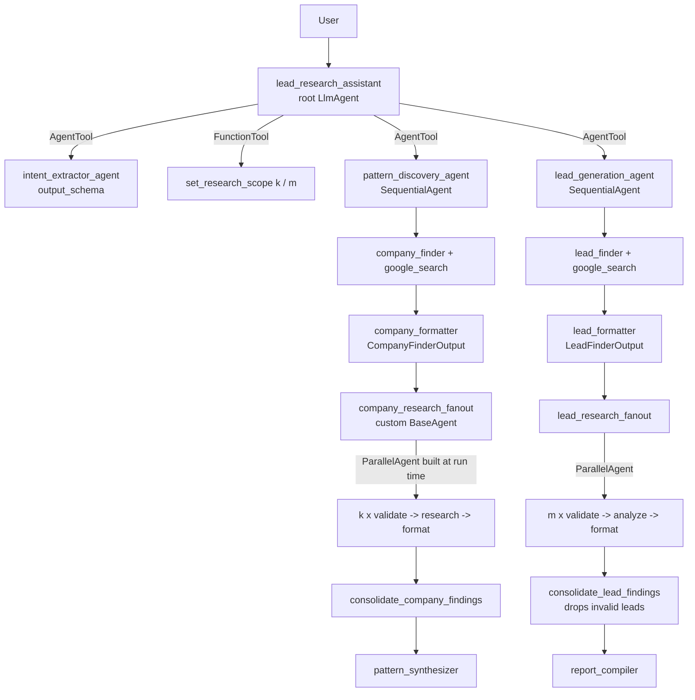
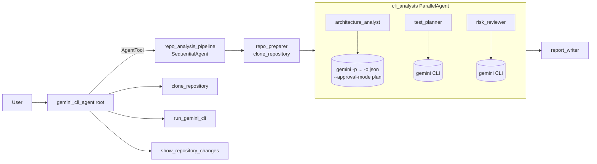
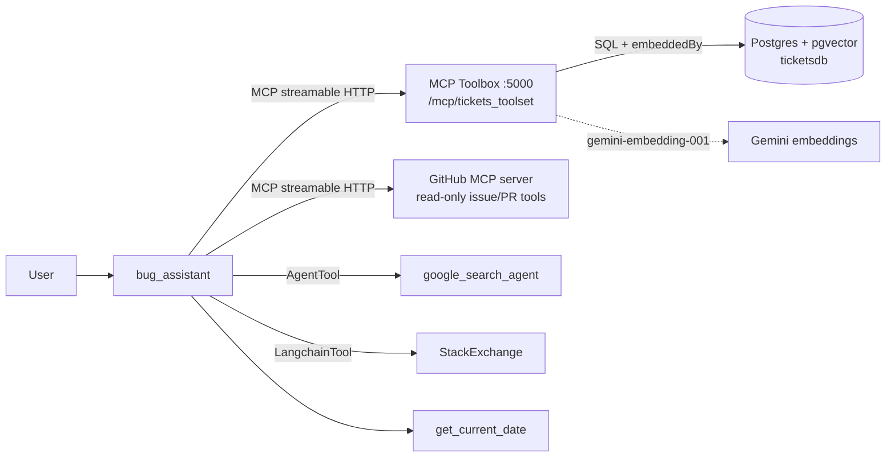
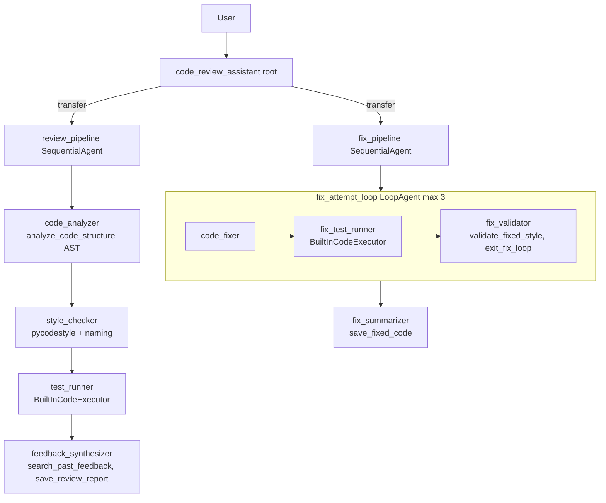
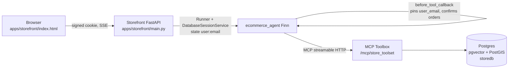

# Code walkthrough

One section per agent: what it does, how the ADK pieces fit together, the files to open
in order, and what changed relative to the reference implementation.

All five live under `agents/`, so `uv run adk web agents` lists them in one dev UI and
`server.py` serves them all through one production API.

---

## (a) Deep research agent for lead generation

**Goal:** given "find fintech leads in Thailand", learn what foreign fintechs did in the
months *before* they entered Thailand, then find companies doing those things *now*.

Files, in reading order:

1. `agents/lead_generation_agent/agent.py`: the root agent, its tools, and two callbacks.
   `init_state` (before_agent) stamps today's date and default state keys.
   `track_stage` (after_tool) copies the intent extractor's structured output into flat
   `country` / `industry` keys that every prompt reads via `{country?}`.
2. `prompts.py`: every instruction. The root prompt is a five-stage state machine:
   understand, scope k, discover, scope m, generate.
3. `sub_agents/pipelines.py`: the two phases as `SequentialAgent`s. Search agents
   (`google_search`) write free text; a separate formatter with `output_schema` turns it
   into JSON. Gemini can't combine the built-in search tool with a response schema in
   one call, so research and structuring are split.
4. `sub_agents/fanout.py`: the deep-research core. `FanOutResearchAgent` reads the
   formatted company list from state and builds one `validator -> researcher -> formatter`
   pipeline per company at run time, wrapped in a `ParallelAgent`. Each branch writes
   indexed keys (`company_findings_0`, ...). `ConsolidateFindingsAgent` merges them and
   writes the result as an `EventActions(state_delta=...)` event.

Changes from the reference (MagnIeeT/leadGenerationAgentADK):
- The reference consolidator assigns `ctx.session.state[...]` directly. That change is
  not recorded as an event, so it can be lost when the pipeline runs inside an
  `AgentTool`, which runs a child session and copies back only event deltas. Here
  consolidation is emitted as a `state_delta` event.
- The reference builds instructions with `str.format(**state)`, which crashes when
  company text contains `{` or `}`. Here company text is rendered as plain lines with
  braces stripped (`describe_company`), and ADK's own `{key?}` injection handles state.
- The reference stops at `get_user_choice` pop-ups. Here the root asks in plain
  conversation and records answers through a validated `set_research_scope` tool
  (k and m are bounded 1..10), so the flow also works over the API and in scripts.
- Lead consolidation drops leads that fail validation and tells the report how many were dropped.

---

## (b) Advanced tool agent: Gemini CLI as a tool inside an ADK pipeline

Files:

1. `agents/gemini_cli_agent/tools.py`: the CLI integration.
   - `clone_repository` accepts only `https://github.com/<owner>/<repo>`, shallow-clones
     into `workspace/`, and returns an inventory (file count, top file types).
   - `run_gemini_cli` runs `gemini -p <task> -m <model> -o json --skip-trust
     --approval-mode plan` as an argv list (no shell). It parses the CLI's JSON output
     and returns the answer, tokens per model, and which CLI tools (read_file, grep,
     glob...) the CLI used. `allow_edits=True` switches to `auto_edit` so the CLI can
     write files, such as generated unit tests.
   - `show_repository_changes` returns `git status` and `git diff` plus the contents of new
     files, so the agent can show exactly what the CLI wrote.
2. `agents/gemini_cli_agent/agent.py`: the pipeline. Three analysts run the CLI in
   parallel with different briefs and write to `architecture_notes`, `test_plan` and
   `risk_review`. `report_writer` merges them with `{key?}` state injection.

Changes from the reference (derrickchwong/gemini-cli-on-adk):
- The reference runs `f'gemini -p "{task}"'` with `shell=True`. A task containing
  quotes or `$(...)` becomes shell injection, and the URL is unvalidated
  (`git clone "{github_url}"`). Here everything is argv lists with URL validation and a
  path-traversal check (`_repo_dir`).
- The reference runs the CLI with default approval and plain text output. Here it is
  read-only by default, JSON output is parsed, and output is size-capped.
- The reference is one agent calling one tool. Here the CLI sits inside a
  Sequential + Parallel ADK pipeline, which is what the assignment asks for.
- `Dockerfile` (repo root) installs Node and `@google/gemini-cli` so the same tool works on Cloud Run.

---

## (c) MCP-tools-based agent for bug assistance

Files:

1. `infra/toolbox/tools.yaml`: the MCP server's tools. Each tool is a parameterized SQL
   statement, so the model never writes SQL. Semantic search uses
   `embeddedBy: gemini-embedder`, so Toolbox embeds the query text before running
   `ORDER BY embedding <=> $1::vector`. `create-new-ticket` uses `valueFromParam` to
   embed the new description on insert, so new tickets are searchable immediately.
   Read tools carry `readOnlyHint` annotations.
2. `agents/bug_assistant/agent.py`: five tool kinds on one agent. Both MCP servers
   connect through ADK's `McpToolset` + `StreamableHTTPConnectionParams`. The GitHub MCP
   server is limited to read-only tools with `tool_filter` and only loads when
   `GITHUB_PERSONAL_ACCESS_TOKEN` is set.
3. `agents/bug_assistant/prompt.py`: the triage procedure. It always searches for
   duplicates before creating a ticket and states a change before making it.
4. `infra/sql/10-tickets.sql` + `scripts/embed_backfill.py`: schema, the
   `updated_time` trigger, an HNSW index, seed tickets, and their embeddings.

Changes from the reference (google/adk-samples software-bug-assistant):
- The reference needs Cloud SQL's `embedding()` SQL function. Here Toolbox's
  `embeddedBy` does the embedding, so the stack runs on any Postgres with pgvector,
  locally in Docker.
- The ticket tools reach the agent over **MCP** (`/mcp/tickets_toolset`), not
  Toolbox's own HTTP client protocol. Both tool sources are real MCP servers.
- Update tools return the updated row, so the agent can confirm the change.

---

## (d) Production-quality code review assistant

Production aspects:
- **Deterministic facts** (`tools.py`): structure from `ast` (functions, length,
  cyclomatic complexity, docstrings, bare excepts) and style from `pycodestyle` plus
  naming checks, with a reproducible 0-100 score. The LLM explains the numbers; it does
  not invent them.
- **Executed tests:** `test_runner` and `fix_test_runner` use Gemini's code execution
  sandbox (`BuiltInCodeExecutor`), so pass/fail counts come from running code.
- **Bounded self-correction:** a `LoopAgent` (max 3 attempts, configurable). The
  validator ends it early through `exit_fix_loop` (`actions.escalate = True`) only when
  tests pass and the style score meets the target.
- **Memory across sessions:** `user:review_history` state records each review's score
  and issue codes. `search_past_feedback` uses it to point out recurring mistakes.
  With the persistent session service in `server.py`, this survives restarts.
- **Artifacts:** `review_report.json` and `fixed_code.py` are saved as versioned ADK
  artifacts (GCS in production via `ARTIFACT_SERVICE_URI=gs://...`).
- **Config:** `config.py` validates settings with pydantic-settings (models, limits, target score).
- **Ops:** `server.py` (persistent DB sessions, `MAX_LLM_CALLS` cap, `/healthz`,
  optional OpenTelemetry to Cloud), the `Dockerfile` (non-root user), `deploy/cloud_run.sh`,
  and unit tests in `tests/test_offline.py`.

Changes from the reference (ayoisio/adk-code-review-assistant):
- The fix offer is produced by the last pipeline agent. Once control transfers into a
  `SequentialAgent`, the root does not speak again in that turn, so the reference's
  root-level "add this at the end" instruction never fires.
- The fixer sees the validator's notes from the previous attempt (`{fix_validation?}`),
  so retries are targeted rather than repeated.

---

## (e) Production-quality e-commerce agent

Files:

1. `infra/sql/store.sql`: the reference AlloyDB dump (100 products, 380 variants, 2,280
   inventory rows, 6 Barcelona stores with PostGIS points, 5 customers) after
   `scripts/sanitize_store_dump.py` removes AlloyDB-only extensions, roles and the ScaNN
   index (replaced by HNSW). Product vectors are recomputed with gemini-embedding-001 so
   they match the query embeddings Toolbox produces.
2. `infra/toolbox/tools.yaml` (store section): 13 tools covering semantic, brand and
   size search, details, per-store inventory, nearest stores (`ST_Distance` with KNN
   `<->`), shopping list, delivery methods, place/update/cancel order, and order history.
3. `agents/ecommerce_agent/agent.py`: the security layer.
   - `enforce_signed_in_user` (before_tool_callback) overwrites `user_email` on every
     customer-scoped tool with `user:email` from session state, which only the server
     sets. Asking "show bob's orders" still returns only the signed-in user's orders.
   - `place-order` and `cancel-order` are blocked until the customer confirms and the
     agent calls `confirm_action`. The confirmation lives in `temp:` state, so it only
     lasts for the current turn.
4. `apps/storefront/`: customer sign-in validated against the `users` table, an
   HMAC-signed HttpOnly cookie, persistent sessions, Server-Sent Events streaming, and
   a chat UI that shows which tools each answer used.

Changes from the reference (mtoscano84/sports-agent-adk-mcp-alloydb):
- In the reference, `update-order-delivery-method` changes any order by id with no
  owner check. Here it and `cancel-order` filter by the signed-in user and
  `order_status = 'pending'`.
- The reference's `place-order` leaves the shopping list full after ordering and
  ignores the delivery method the customer picked. Here the method is a parameter and
  the list is emptied in the same transaction.
- The reference hardcodes its Toolbox URL and rebuilds the agent per request. Here
  config comes from the environment and one `Runner` is reused with persistent sessions.
- `check-inventory-by-store-brand-category` used AlloyDB AI natural-language SQL. It is
  replaced by an explicit `check-inventory` SQL tool that runs on any Postgres.
